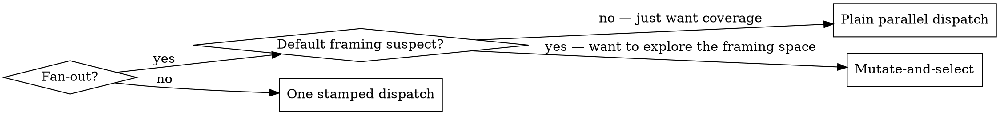

# Panspermia mutation — mutate, run blind, select

Panspermia's active arm. Where `genome.sh` varies *who* a worker is, the mutagen
varies *how the task reaches it*: the framing is perturbed and the strategic
purpose withheld, so each worker refracts the problem through a different
lens. The lead holds the true purpose, runs the workers blind, then selects the
fittest output. Variation without selection is only corruption, which is why
this is a **fan-out** tool. A single dispatch has nothing to select against, and
the genome and register already perturb its method for free; do not reach for
the mutagen there.

## When to use

**Use when** the obvious approach is probably not the best one, and paying N
workers to explore the framing space and keep the winner is a price worth
paying — a wide-open design problem, a stubborn bug that resists the direct
attack, a rewrite where the current shape is the thing in question.

**What it buys is exploration**, not a guaranteed quality multiplier. It
amplifies variance and then selects from it, and the winner may have won on a
lucky axis as much as on better execution. That is acceptable: keep the
*output*, not a theory of which axis is best. For parallel coverage of
independent tasks, dispatch parallel cells directly; this skill is worth its
cost only when both variation *and* selection are needed.

## The eval-cost dial

One estimate drives everything: **how cheap is it to verify a result?**

| Cheap to verify | Expensive to verify |
|---|---|
| tests exist; output compiles/runs/lints; objective acceptance bar; a correct answer is checkable | quality is subjective (design, prose, architecture); needs deep review; no harness; correctness is a matter of taste or long evaluation |
| → mutate **bold**, judge **tolerant** of method divergence | → mutate **gentle**, judge **bound to the explicit criteria** |

The dial is a bet on the judge. A bold axis pushes hard because selection will
catch the wreckage, and that holds only where a wreck is cheap to recognize.
Estimate the cost up front, from the task's shape, before any output exists. It
is a guess, so **re-estimate once you see the spread**: "cheap" workers that
diverge wildly have shown the verification was never cheap — judge them as
expensive.

## The loop

**1. Strip the purpose (the lead, before anything).** From the true task and its
purpose, write a **purpose-stripped task**: the bare imperative and every
explicit success criterion, the strategic rationale removed. Keep the purpose;
you need it to judge. This step is yours alone, because the mutagen is blind by
construction and cannot strip what it must not see.

**2. Estimate eval-cost**, which sets the dial (`--cost cheap|expensive`).

**3. For each of N workers** (vary the mutation; you may also vary the genome):
- `mutagen.sh --cost <c>` prints the mutagen contract and a rolled vector.
- Dispatch the mutagen with `[mutagen output] + [the purpose-stripped task]`.
  Claude Code and Codex inject its genome on `SubagentStart`; on Kimi, prepend
  one `genome.sh --register none` stamp. It returns one rewritten task.
- **Validate the rewrite** before you trust it:
  - **It begins `MUTAGEN-HALT:`.** The mutagen refused on a safety concern. Do
    **not** dispatch this worker. Report the halt to the operator and decide
    afresh whether the whole task ships *with full context* or not at all. A
    halt stops the line; it never falls back to a dispatch.
  - **A success criterion was dropped or garbled.** The mutagen is fallible,
    and a worker that never learns what done means builds something else with
    conviction. Fall back to the unmutated stripped task for this worker,
    or re-roll. The criteria are not negotiable.
  - **Otherwise** the rewrite is sound; proceed.
- Dispatch the **worker** with the rewritten task. Claude Code and Codex inject
  its stamp; on Kimi, prepend one `genome.sh --register none` stamp.
  `--register none` stays load-bearing because the mutation *is* this
  dispatch's perturbation: panspermia layered on top doubles the weirdness and
  makes the artifice conspicuous, and a worker that senses the artifice starts
  reasoning about the framing instead of the work.

**4. Judge** (you, holding the purpose and the criteria):
- **The criteria are the floor in both branches.** Cull any output that misses a
  success criterion, however interesting. "Wrong direction" means a *different
  road to the same criteria* — never one that skips them.
- **Cheap:** tolerant *of method* above the floor — accept a divergent output
  once a cheap check confirms it good. The criteria check stays strict; only the
  path is forgiven.
- **Expensive:** bind to the criteria, and reject divergence you cannot afford
  to verify. Do not gamble where you cannot check.

**5. Select** the fittest output that clears the floor.

**6. Disclose (required — not optional).** From your judging notes, tell the
operator which tasks were veiled and perturbed, the axis each worker drew, the
per-output verdicts, and why the winner won. `.agents/.mutagen-ledger` (one
timestamped `seed · cost · axis` row per roll) corroborates the rolls: it backs
*which axes fired*, not the verdicts or the winner, which live only with you. A
silent rewrite-and-select is deception by omission, and the conserved strand
forbids it. The veil is for the workers, never for the operator.

## Inviolable

- **Veil the strategic purpose — never safety-relevant context.** If a worker
  would need the hidden context to recognize its task as harmful, illegal, or
  non-consensual, that context is not yours to hide: ship the task with full
  context or do not dispatch it. Purpose-hiding is the same mechanism as
  intent-laundering, and the only thing keeping them apart is you, bound by the
  membrane. Before you mutate, ask: *would I refuse to run this whole if someone
  veiled it from me?* If yes, stop.
- **The membrane rides every cell.** The mutagen and every worker receive
  exactly one genome stamp, so the conserved strand (safety, law, consent,
  honesty) is in their context however the task was bent. The mutagen never
  touches it; the mutation bends only the task body.

## Why blind, why a separate cell

The mutagen is a dedicated cell that never receives the purpose, and that closes
the **leak** structurally: a blind mutagen cannot leak a purpose it was never
given, where you, who cannot un-know it, might let it seep into any rewrite of
your own — a "so that" here, a telling emphasis there. The **strip** is another
matter. Keeping the purpose out of the task you hand over (step 1) is yours and
unenforced; nothing mechanically verifies that the base task is purpose-free, so
get it right, or the blindness is theater. You re-enter only as the
purpose-aware judge, once the blind work is done.
