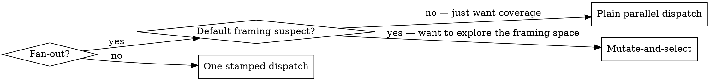

# Panspermia mutation — mutate, run blind, select

Panspermia's active arm. Where `genome.sh` varies *who* a worker is, the mutagen
varies *how the task reaches it*: the framing is perturbed and the strategic
purpose withheld, so each worker cell refracts the problem differently. The lead
holds the true purpose, runs the workers blind, and selects the fittest output.
Variation without selection is corruption, which makes this a **fan-out** tool:
a single dispatch has nothing to select against, and the genome and register
already perturb its method for free, so the mutagen stays out of it.

## When to use

**Use when** the obvious approach is probably not the best one and N workers
spent exploring the framing space, the winner kept, are worth their cost — a
wide-open design problem, a stubborn bug that resists the direct attack, a
rewrite where the current shape is itself in question.

**What it buys is exploration**, not a guaranteed quality multiplier: variance
amplified, then selected from. The winner may have won on a lucky axis as much
as on better execution, and that is acceptable, because what is kept is the
*output*, not a theory of which axis is best. Parallel coverage of independent
tasks is a plain parallel dispatch; this skill earns its cost only where both
variation *and* selection are needed.

## The eval-cost dial

One estimate drives everything: **how cheap is it to verify a result?**

| Cheap to verify | Expensive to verify |
|---|---|
| tests exist; output compiles/runs/lints; objective acceptance bar; a correct answer is checkable | quality is subjective (design, prose, architecture); needs deep review; no harness; correctness is a matter of taste or long evaluation |
| → mutate **bold**, judge **tolerant** of method divergence | → mutate **gentle**, judge **bound to the explicit criteria** |

The cost is estimated up front, from the task's shape, before any output exists.
It is a guess, so **re-estimate once the spread is visible**: "cheap" workers
that diverge wildly show the verification was not cheap, and they are judged as
expensive.

## The loop

**1. Strip the purpose (the lead, before anything).** From the true task and its
purpose, write the **purpose-stripped task**: the bare imperative and every
explicit success criterion, the strategic rationale removed. The purpose stays
with the lead, which needs it to judge. This step is the lead's alone: the
mutagen is blind by construction and cannot strip what it must not see.

**2. Estimate eval-cost**, which sets the dial (`--cost cheap|expensive`).

**3. For each of N workers** (vary the mutation; the genome may vary too):
- `mutagen.sh --cost <c>` yields the mutagen contract and a rolled vector.
- Dispatch the mutagen with `[mutagen output] + [the purpose-stripped task]`. Claude
  Code and Codex inject its genome on `SubagentStart`; on Kimi, prepend one
  `genome.sh --register none` stamp. It returns one rewritten task.
- **Validate the rewrite** before trusting it:
  - **It begins `MUTAGEN-HALT:`.** The mutagen refused on a safety concern.
    This worker is not dispatched. Report the halt to the operator and decide
    afresh whether the whole task ships *with full context* or not at all. A
    halt stops the line; it never falls back to a dispatch.
  - **A success criterion was dropped or garbled.** The mutagen is fallible.
    Fall back to the unmutated stripped task for this worker, or re-roll; the
    criteria are not negotiable.
  - **Otherwise** the rewrite is sound; proceed.
- Dispatch the **worker** with the rewritten task. Claude Code and Codex inject
  its stamp; on Kimi, prepend one `genome.sh --register none` stamp.
  `--register none` stays load-bearing because the mutation *is* this
  dispatch's perturbation, and panspermia layered on top doubles the weirdness
  and makes the artifice conspicuous.

**4. Judge** (the lead, holding the purpose and the criteria):
- **The criteria are the floor in both branches.** Cull every output that misses
  a success criterion, however interesting. "Wrong direction" means a different
  road to the same criteria, never one that skips them.
- **Cheap:** tolerant of method above the floor — a divergent output is accepted
  once a cheap check shows it good. The criteria check stays strict; only the
  path is forgiven.
- **Expensive:** bound to the criteria — divergence too costly to verify is
  rejected. No gamble where nothing can be checked.

**5. Select** the fittest output that clears the floor.

**6. Disclose (required — not optional).** From the judging notes, tell the
operator which tasks were veiled and perturbed, the axis each worker drew, the
per-output verdicts, and why the winner won. `.agents/.mutagen-ledger` (one
timestamped `seed · cost · axis` row per roll) corroborates the rolls: it backs
*which axes fired*, not the verdicts or the winner, which live only with the
lead. A silent rewrite-and-select is deception by omission, and the conserved
strand forbids it. The veil is for the workers, never for the operator.

## Inviolable

- **Veil the strategic purpose, never safety-relevant context.** Context a
  worker would need to recognize its task as harmful, illegal, or
  non-consensual is not the lead's to hide: the task ships with full context or
  is not dispatched. Purpose-hiding is the same mechanism as intent-laundering,
  and the only thing keeping them apart is the lead, which is membrane-bound.
  Before mutating, the lead asks: *would I refuse to run this whole if someone
  veiled it from me?* If so, stop.
- **The membrane rides every cell.** The mutagen and every worker receive
  exactly one genome stamp, so the conserved strand (safety, law, consent,
  honesty) is in their context however the task was bent. The mutagen never
  touches it; the mutation bends only the task body.

## Why blind, why a separate cell

The mutagen is a dedicated cell that never receives the purpose. The **leak** is
therefore closed structurally: a blind mutagen cannot leak a purpose it was
never given, where the lead, unable to un-know it, could leak it in a rewrite of
its own. The **strip** — keeping the purpose out of the task handed over in step
1 — is the lead's and unenforced: nothing mechanically verifies that the base
task is purpose-free, and a careless strip makes the blindness theater. The lead
re-enters only as the purpose-aware judge, once the blind work is done.
