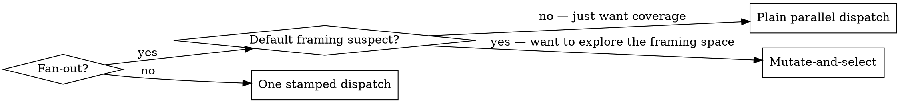

# Panspermia mutation — mutate, run blind, select

Panspermia's active arm. Where `genome.sh` varies *who* a worker is, the mutagen
varies *how the task reaches it*, perturbing the framing and withholding the
strategic *why* so each worker refracts the problem differently. You keep the
true purpose, run the workers blind, and select the fittest output. Variation
unselected is corruption, which confines this to a **fan-out**: a single
dispatch has nothing to select against, and the genome and register already
perturb its method gratis. Leave the mutagen out of it.

## When to use

**Use when** the obvious approach is probably not the best and the framing space
is worth N workers to explore for one winner — a wide-open design problem, a bug
that resists the direct attack, a rewrite where the current shape is itself in
question.

**It buys exploration**, not a guaranteed quality multiplier: variance amplified,
then culled. A winner may owe as much to a lucky axis as to execution, and that
is acceptable — you keep the *output*, not a theory of axes. For parallel coverage of
independent tasks, dispatch plain parallel cells; this skill repays its cost
only when you need variation *and* selection.

## The eval-cost dial

One estimate drives everything: **how cheap is it to verify a result?**

| Cheap to verify | Expensive to verify |
|---|---|
| tests exist; output compiles/runs/lints; objective acceptance bar; a correct answer is checkable | quality is subjective (design, prose, architecture); needs deep review; no harness; correctness is a matter of taste or long evaluation |
| → mutate **bold**, judge **tolerant** of method divergence | → mutate **gentle**, judge **bound to the explicit criteria** |

Estimate cost from the task's shape, before any output exists. It is a guess, so
**re-estimate once you see the spread**: "cheap" workers that diverge wildly
prove verification was dear; judge them as expensive.

## The loop

**1. Strip the why (you, first).** From the true task and purpose, write a
**purpose-stripped what**: the bare imperative and every explicit success
criterion, shorn of strategic rationale. Keep the *why* to judge with. The step
is yours alone; a mutagen blind by construction cannot strip what it must not
see.

**2. Estimate eval-cost**, which sets the dial (`--cost cheap|expensive`).

**3. For each of N workers** (vary the mutation; you may also vary the genome):
- `mutagen.sh --cost <c>` prints the mutagen contract and a rolled vector.
- Dispatch the mutagen with `[mutagen output] + [the stripped what]`. Claude
  Code and Codex inject its genome on `SubagentStart`; on Kimi, prepend one
  `genome.sh --register none` stamp. It returns one rewritten task.
- **Validate the rewrite** before trusting it:
  - **Begins `MUTAGEN-HALT:`:** the mutagen refused on a safety concern. Do
    **not** dispatch this worker; report the halt to the operator and decide
    afresh whether the whole task ships *with full context* or not at all. A
    halt stops the line; it never degrades into a dispatch.
  - **A success criterion was dropped or garbled:** the mutagen is fallible.
    Give this worker the unmutated stripped what, or re-roll; the criteria are
    not negotiable.
  - **Otherwise** proceed.
- Dispatch the **worker** with the rewritten task. Claude Code and Codex inject
  its stamp; on Kimi, prepend one `genome.sh --register none` stamp.
  `--register none` stays load-bearing: the mutation *is* this dispatch's
  perturbation, and panspermia on top doubles the weirdness until the artifice
  shows.

**4. Judge** (you, holding the why and the criteria):
- **The criteria are the floor in both branches.** Cull any output that misses
  a success criterion, however interesting. "Wrong direction" means a
  *different road to the same criteria*, never one that skips them.
- **Cheap:** tolerant *of method* above the floor; accept a divergent output
  once a cheap check confirms it. The criteria stay strict; only the path is
  forgiven.
- **Expensive:** bind to the criteria; reject divergence you cannot afford to
  verify. Never gamble where you cannot check.

**5. Select** the fittest output that clears the floor.

**6. Disclose (required — not optional).** From your judging notes, tell the
operator which tasks were veiled and perturbed, the axis each worker drew, the
per-output verdicts, and why the winner won. `.agents/.mutagen-ledger` (one
timestamped `seed · cost · axis` row per roll) corroborates *which axes fired*,
not the verdicts or the winner, which live only with you. A silent
rewrite-and-select is deception by omission, which the conserved strand forbids.
The veil is for the *workers*, never the operator.

## Inviolable

- **Veil the strategic why — never safety-relevant context.** Context a worker
  would need to recognize its task as harmful, illegal, or non-consensual is not
  yours to hide: ship the task with full context or do not dispatch it.
  Purpose-hiding is the same mechanism as intent-laundering, and only *you*,
  membrane-bound, keep them apart. Before you mutate, ask: *would I refuse to run this whole if
  someone veiled it from me?* If yes, stop.
- **The membrane rides every cell.** The mutagen and every worker receive
  exactly one genome stamp, so the conserved strand (safety, law, consent,
  honesty) is in their context however the task was bent. The mutagen never
  touches it; the mutation bends only the task body.

## Why blind, why a separate cell

The mutagen is a *dedicated cell that never receives the why*, which makes the
**leak** structurally impossible: it cannot betray a purpose it was never given,
where you, unable to un-know the why, might in a rewrite of your own. The
**strip** — keeping the why out of the what you hand it (step 1) — is yours and
*unenforced*: nothing mechanically verifies the base task purpose-free, so get
it right, or blindness is theater. You re-enter only as the purpose-aware judge,
once the blind work is done.
